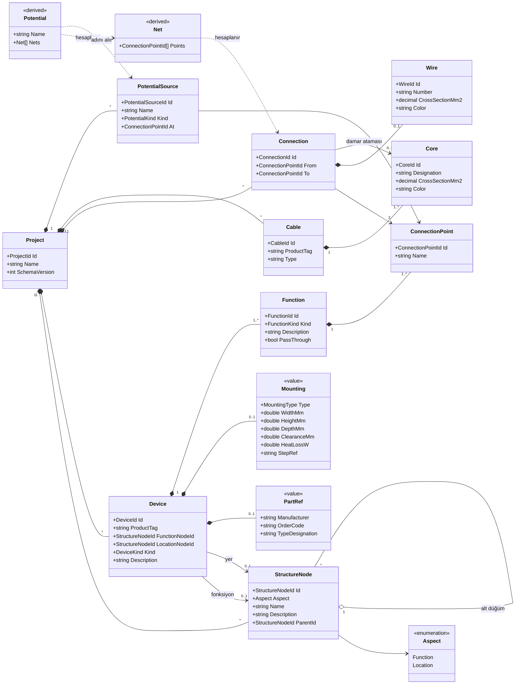
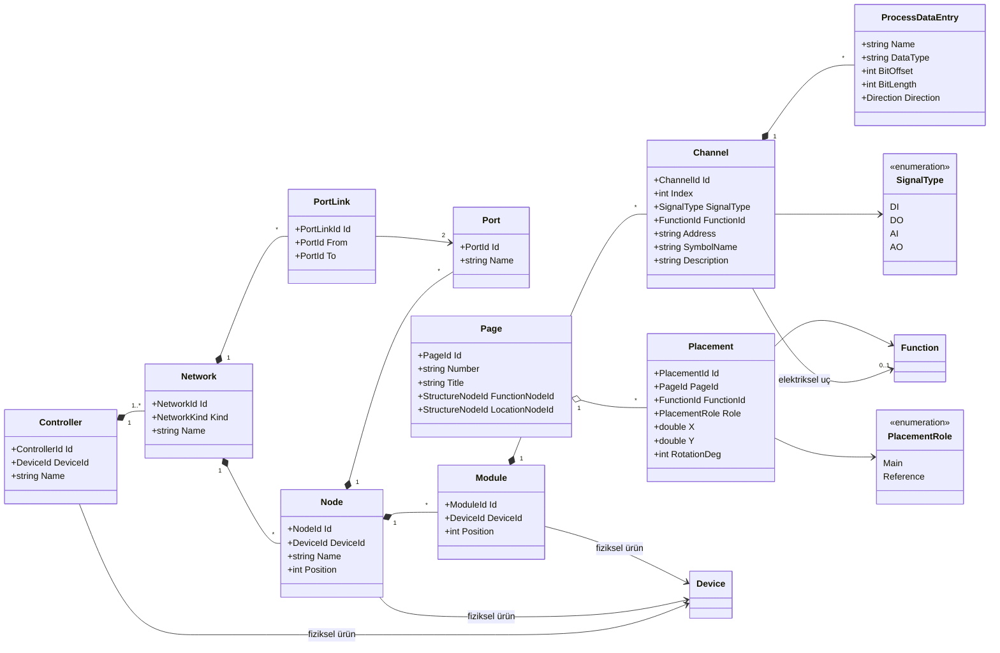

# Faz 1 — Elektriksel veri modeli: taslak ve açık sorular

- **Durum:** Onaylandı ve uygulandı (2026-11-15). Kesinleşen kararlar ve taslaktan farklar:
  [ADR-0003](adr/0003-elektriksel-veri-modeli.md)
- **Tarih:** 2026-11-15
- **Kaynak:** `ROADMAP.md` Faz 1, ADR-0001, ADR-0002

Bu belge kod yazılmadan önceki öneridir ve o haliyle saklanır; açık soruların hepsi önerildiği
gibi onaylandı. Güncel durum için ADR-0003'e ve koda bakın.

## Kapsam

| Modül | Bu fazda eklenecek |
|---|---|
| `Ake.Core` | Model sınıfları, IEC 81346 tag'i, net/potansiyel hesabı |
| `Ake.Serialization` | JSON okuma/yazma, şema versiyonu, round-trip |
| `examples/ref-machine/` | Elle yazılmış referans makine JSON'u |
| `tests/` | Model, net hesabı ve round-trip testleri |

Kapsam dışı: Command'lar ve undo/redo (Faz 2), ERC kuralları (Faz 2), kütüphaneden device üretme
(Faz 4), çizim (Faz 5). Faz 1'de model yalnızca JSON'dan yüklenir ve geri yazılır.

## Temel ayrımlar

**Device / Function.** Device satın alınan fiziksel üründür (`-K1`, LC1D09). Function o ürünün
elektriksel bir parçasıdır: bobin, NO kontak, güç kontağı. Şemada çizilen ve bağlanan şey
Function'dır; BOM'da sayılan şey Device'dır. Bir kontaktörün bobini 3. sayfada, yardımcı kontağı
7. sayfada durabilir; ikisi de aynı Device'a aittir.

**Connection / Net / Potential.** Connection kullanıcının kurduğu, iki bağlantı noktası
arasındaki tek bağdır ve saklanır. Net ve Potential saklanmaz, Connection'lardan hesaplanır:

- **Net:** tellerle doğrudan birbirine bağlı bağlantı noktaları kümesi. Her cihazda durur.
- **Potential:** klemens gibi "içinden geçen" function'lar üzerinden birleşen net'ler kümesi.
  Adını (`L1`, `24VDC`, `0V`) bir `PotentialSource` işaretinden alır.

**Model / Placement.** Placement yalnızca "şu function şu sayfada şu konumda çizili" bilgisidir.
Silinmesi ya da taşınması elektriksel modeli değiştirmez. Bir function'ın bir ana, birden çok
referans görünümü olabilir; hiç yerleştirilmemiş function da geçerlidir.

## Sınıf diyagramı — elektriksel çekirdek

Notlar:

- `=` ve `+` aspect'leri `StructureNode` ağacıdır. `-` aspect'i Device'ın kendi `ProductTag`
  alanıdır. Tam tag (`=A1+S1-K1`) saklanmaz, bu üçünden üretilir; bağlantı noktası için
  `=A1+S1-K1:A1` biçimi kullanılır.
- Klemens grubu ayrı bir sınıf değildir: `Kind = TerminalStrip` olan bir Device'dır (`-X1`),
  her klemens `Kind = Terminal`, `PassThrough = true` olan bir Function'dır. Köprü, klemensler
  arası bir Connection'dır.
- Bir Connection'ın ortamı ya Wire'dır, ya bir kablo damarıdır, ya da hiçbiridir (köprü, bara).
  İkisi birden olamaz.

## Sınıf diyagramı — PLC topolojisi ve grafik temsil

Notlar:

- PLC ağacı, Device'ların üzerine kurulmuş ikinci bir görünümdür. EL1008 hem BOM'da sayılan
  bir Device'dır (`-A12`), hem de EtherCAT zincirinde 2. sıradaki Module'dür. İkisi `DeviceId`
  ile bağlanır; bilgi tekrarlanmaz.
- Channel'ın elektriksel ucu, o Device'ın bir Function'ıdır. Sensör teli o Function'ın bağlantı
  noktasına gider; adres ve sembolik ad Channel'da durur.
- Rockwell rack/slot yapısı: Node = şasi, `Module.Position` = slot numarası.

## Net ve potansiyel hesabı

1. Her bağlantı noktası kendi kümesinde başlar.
2. Her Connection iki ucunun kümesini birleştirir. Sonuç: **Net**'ler.
3. `PassThrough = true` olan her Function'ın bütün bağlantı noktaları birleştirilir. Sonuç:
   **Potential**'ler.
4. Bir potansiyelin adı, içindeki `PotentialSource` işaretinden gelir. İşaret yoksa adsızdır;
   farklı adlı iki işaret aynı potansiyele düşerse bu Faz 2'de ERC kısa devre hatası olur
   (Faz 1'de yalnızca tespit edilir, raporlanmaz).

Hesap saf fonksiyondur: `Project` alır, sonucu döner, modeli değiştirmez.

## İş kalemleri (her biri ayrı commit)

1. Tipli ID'ler ve IEC 81346 tag'i (ayrıştırma + üretme)
2. `Project`, `StructureNode`, `Device`, `Function`, `ConnectionPoint`
3. `Connection`, `Wire`, `Cable`, `Core`
4. `PotentialSource` ve net/potansiyel hesabı
5. `Mounting` ve `PartRef`
6. PLC topolojisi
7. `Page` ve `Placement`
8. JSON serileştirme, şema versiyonu, round-trip testleri
9. `examples/ref-machine/` ve uçtan uca test (DoD)
10. ADR-0003

## Açık sorular

Her sorunun altında önerim var; onaylarsanız öneri uygulanır.

### Device / Function / Potential

1. **Net ve Potential iki ayrı kavram mı olsun?**
   Öneri: evet. Tel numaralandırma net'e, kısa devre kontrolü ve sayfalar arası potansiyel oku
   potansiyele bakar. Tek kavramla klemensin iki yanı ya hep aynı ya hep ayrı görünür.

2. **Potansiyel adı nereden gelsin?**
   Öneri: ayrı bir `PotentialSource` işaretinden (besleme ucuna konur). Alternatif, adı her
   Connection'a yazmaktır; bu durumda aynı bilgi yüzlerce yerde tekrarlanır ve çelişebilir.

3. **Klemens grubu ayrı sınıf mı, Device mı?**
   Öneri: Device + Function. Böylece klemens de BOM'a, tag'lemeye ve bağlantıya aynı yoldan
   girer. Karşılığında çok katlı klemens ve iç/dış taraf bilgisi Function özelliği olarak
   taşınır; bunun yeterli olup olmadığı Faz 3 terminal planında belli olacak.

4. **Sigorta, şalter, kontak gibi anahtarlayan function'lar potansiyeli böler mi?**
   Öneri: evet, böler (`PassThrough = false`). `L1` sigortadan sonra ayrı bir potansiyeldir.
   Yalnızca klemens, bara ve köprü geçirgendir.

5. **Function türleri sabit enum mu, açık liste mi?**
   Öneri: Faz 1'de küçük bir enum (Coil, NoContact, NcContact, PowerContact, Terminal,
   Protection, Motor, PowerSupply, PlcChannel, Generic). Kütüphane geldiğinde (Faz 4)
   yetersiz kalırsa şablona taşınır.

### Placement bağımsızlığı

6. **Placement neyi gösterir: Function'ı mı, Device'ı mı?**
   Öneri: yalnızca Function. Device'ın tamamını gösteren pano görünümü Faz 8'in ayrı
   modelidir.

7. **Telin çizim yolu modelde mi dursun?**
   Öneri: hayır. Connection mantıksal bağdır; ekrandaki kırıklı yol Faz 5'te ayrı bir grafik
   nesne olur. Faz 1'de tel geometrisi hiç yok.

8. **Sayfa Faz 1'de ne kadar ayrıntılı olsun?**
   Öneri: yalnızca kimlik, numara, başlık ve yapı düğümü. Çerçeve, antet ve grid Faz 5'te.

### Model ve dosya

9. **Model sınıfları değiştirilebilir mi, değişmez (immutable) mi?**
   Öneri: değiştirilebilir, ama değiştiren üyeler `internal`. Dışarıdan yalnızca okunur;
   Faz 2'de Command'lar Core içinden değiştirir. Değişmez model undo'yu kolaylaştırır ama
   300 sayfalık projede her değişiklikte kopya üretir.

10. **JSON'dan yükleme "yalnızca Command" kuralının istisnası mı?**
    Öneri: evet. Yükleme bir değişiklik değil, modelin kurulmasıdır; `Ake.Serialization`
    Core'un açık bir kurucu API'sini kullanır. Audit log'a yazılmaz.

11. **Proje tek JSON dosyası mı, klasör mü?**
    Öneri: Faz 1'de tek dosya, kararlı sıralamayla (git diff'i küçük kalsın). Büyük projede
    sayfa başına dosyaya bölmek şema versiyonu üzerinden sonradan yapılabilir.

12. **ID biçimi.**
    Öneri: tipli ID'ler (`DeviceId`, `FunctionId`…), içeride GUID v7. Elle yazılan referans
    JSON'da GUID yazmak zahmetli olacak; buna rağmen kısa ID yerine GUID'de kalmayı
    öneriyorum, çünkü birleştirme ve import'ta çakışma olmaz.

13. **Referans makinenin PLC'si hangi platform olsun?**
    Öneri: Beckhoff, çünkü Faz 7'nin birinci hedefi TwinCAT. IPC + EK1100 + EL1008 (8 DI) +
    EL2008 (8 DO) = 16 I/O. Yol haritasındaki "1 PLC rack" ifadesini bu şekilde yorumluyorum.

14. **Kod dili.**
    Öneri: tip ve üye adları İngilizce, belgeler ve hata mesajları Türkçe (Faz 0'da böyle
    başladı).
