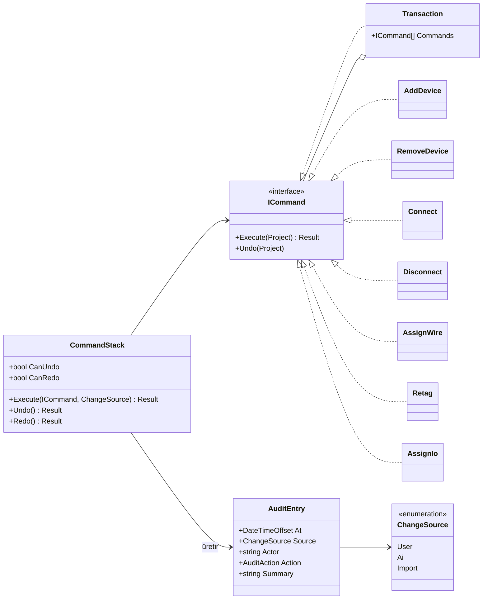
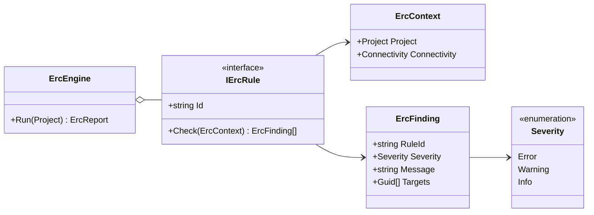

# Faz 2 — Command API ve ERC: plan ve açık sorular

- **Durum:** Onaylandı ve uygulandı (2026-11-15). Kesinleşen kararlar:
  [ADR-0004](adr/0004-command-ve-patch.md) ve [ADR-0005](adr/0005-erc-ve-numaralandirma.md)
- **Tarih:** 2026-11-15
- **Kaynak:** `ROADMAP.md` Faz 2, ADR-0001, ADR-0002, ADR-0003

Bu belge kod yazılmadan önceki öneridir ve o haliyle saklanır; açık soruların hepsi önerildiği
gibi onaylandı. Güncel durum için ADR-0004, ADR-0005 ve koda bakın.

## Kapsam

| Modül | Bu fazda eklenecek |
|---|---|
| `Ake.Core` | Command'lar, `CommandStack`, transaction, audit kaydı, ERC motoru ve kuralları, numaralandırma |
| `Ake.Serialization` | Patch dosyası (JSON) okuma/yazma, audit log dosyası |
| `Ake.Cli` | `ake validate`, `ake renumber`, `ake apply` |
| `examples/ref-machine/` | Örnek patch dosyaları |
| `tests/` | Her command için execute/undo/redo, her ERC kuralı için olumlu ve olumsuz durum, CLI uçtan uca |

Kapsam dışı: rapor üretimi (Faz 3), kütüphaneden device üretme (Faz 4), editördeki grafik
command'lar (taşıma, döndürme; Faz 6), AI'ın patch üretmesi (Faz 9). Bu fazda patch'i insan ya da
test yazar.

## Tasarım

### Command



- `Execute` önce ön koşulları denetler. Koşul sağlanmıyorsa model **hiç değişmeden** `Result.Failure`
  döner (ADR-0002). Başarılıysa command, geri alma için gereken bilgiyi kendi içinde tutar.
- `Undo` yalnızca başarıyla çalışmış command'da çağrılır ve başarısız olamaz; olursa bu programcı
  hatasıdır (exception).
- `Transaction` birden çok command'ı tek adım yapar. Biri başarısız olursa önce çalışanlar ters
  sırayla geri alınır ve transaction başarısız döner. Undo yığınında tek kayıttır.
- Her başarılı command'dan sonra model, `Project.Create`'in denetlediği iç tutarlılığı korur.
  Bunu her command testinde ayrıca doğrulayan ortak bir test yardımcısı olacak.
- Command'lar `Ake.Core` içindedir ve modelin `internal` üyelerini kullanır; Core dışından model
  hâlâ yalnızca okunur.

### Temel command'lar

| Command | Yaptığı | Geri alma için tuttuğu |
|---|---|---|
| `AddDevice` | Device'ı function ve bağlantı noktalarıyla ekler | Eklenen device'ın kimliği |
| `RemoveDevice` | Device'ı ve ona bağlı her şeyi kaldırır | Kaldırılan device, bağlantılar, potansiyel işaretleri, yerleşimler, kanal atamaları |
| `Connect` | İki nokta arasında Connection kurar | Eklenen bağlantının kimliği |
| `Disconnect` | Connection'ı kaldırır | Kaldırılan bağlantı (teli ve damar ataması dahil) |
| `AssignWire` | Bağlantının telini ya da kablo damarını atar, değiştirir, kaldırır | Önceki ortam |
| `Retag` | Device'ın ürün tag'ini ve/veya yapı düğümlerini değiştirir | Önceki değerler |
| `AssignIo` | Kanalın function'ını, sembolik adını, adresini, açıklamasını değiştirir | Önceki değerler |

### Patch formatı

Patch, bir transaction'ın dosyadaki halidir: ya tamamı uygulanır ya hiçbiri.

```json
{
  "patchVersion": 1,
  "source": "user",
  "actor": "baris",
  "description": "Motor 3 kontaktörü eklendi",
  "commands": [
    {
      "op": "addDevice",
      "tag": "=M1+P1-K3",
      "functions": [
        { "kind": "Coil", "connectionPoints": ["A1", "A2"] },
        { "kind": "NoContact", "connectionPoints": ["13", "14"] }
      ]
    },
    { "op": "connect", "from": "-K3:A2", "to": "-T1:-", "wire": { "crossSectionMm2": 0.75, "color": "DBU" } },
    { "op": "assignIo", "channel": "-A12:3", "symbolName": "bM3Run", "description": "Motor 3 çalış" }
  ]
}
```

### ERC



- Kurallar saf fonksiyondur: modeli değiştirmez, aynı model her zaman aynı bulguları aynı sırada verir.
- `Targets` bulgunun ilgili nesnelerinin kimlikleridir; Faz 6'da "tıkla → nesneye git" bunu kullanır.
- `Connectivity` bir kez hesaplanır ve bütün kurallara verilir.

| Kural | Kimlik | Önerilen şiddet |
|---|---|---|
| Açık uç | `erc.acik_uc` | Uyarı |
| Kısa devre (farklı adlı potansiyeller birleşmiş) | `erc.kisa_devre` | Hata |
| Tekrarlanan tag | `erc.tag_tekrar` | Hata |
| Tekrarlanan tel numarası | `erc.tel_no_tekrar` | Hata |
| Kesit / koruma uyumsuzluğu | `erc.kesit_koruma` | Hata |
| Atanmamış I/O kanalı | `erc.io_atanmamis` | Uyarı |
| Çift I/O ataması | `erc.io_cift` | Hata |
| Yetim nesne | `erc.yetim` | Uyarı |

### Numaralandırma

Numaralandırma servisi modeli doğrudan değiştirmez; bir `Transaction` (içi `Retag` ve
`AssignWire` command'ları) üretir. Böylece yeniden numaralandırma da tek adımda geri alınır ve
audit log'a yazılır.

### CLI

```text
ake validate <proje.json> [--json]
ake renumber <proje.json> (--tags | --wires) [--dry-run]
ake apply <proje.json> <patch.json> [--out <dosya>] [--dry-run]
```

Çıkış kodları ADR-0002'deki gibidir: 0 başarılı, 1 kullanım hatası ya da beklenen başarısızlık,
2 beklenmeyen hata. `ake validate` ERC'de hata şiddetinde bulgu varsa 1 döner.

## İş kalemleri (her biri ayrı commit)

1. Modelin `internal` değiştirme üyeleri ve tutarlılık test yardımcısı
2. `ICommand`, `CommandStack`, undo/redo
3. `Transaction` ve atomiklik
4. `AddDevice`, `RemoveDevice`
5. `Connect`, `Disconnect`, `AssignWire`
6. `Retag`, `AssignIo`
7. Audit kaydı ve audit log dosyası
8. Patch formatı (okuma, referans çözme, transaction'a çevirme)
9. ERC motoru ve bağlantı kuralları (açık uç, kısa devre, kesit/koruma)
10. ERC adlandırma ve I/O kuralları (tag, tel numarası, I/O, yetim)
11. Numaralandırma servisleri
12. `ake validate`, `ake apply`, `ake renumber`
13. Referans makine üzerinde uçtan uca test ve örnek patch'ler (DoD)
14. ADR-0004 ve ADR-0005

## Açık sorular

Her sorunun altında önerim var; onaylarsanız öneri uygulanır.

### Command ve undo

1. **Undo nasıl çalışsın: ters işlem mi, anlık görüntü mü?**
   Öneri: ters işlem. Her command geri almak için gerekeni kendi tutar. Anlık görüntü yazması
   kolaydır ama 300 sayfalık projede her adımda bütün modeli kopyalar (bellek hedefi 300 MB).

2. **Bağlantıları olan bir device silinirse ne olsun?**
   Öneri: zincirleme silinsin. Device ile birlikte bağlantıları, üzerindeki potansiyel
   işaretleri ve yerleşimleri kaldırılır, PLC kanal atamaları boşaltılır; undo hepsini geri getirir.
   Alternatif, önce bağlantıların elle kaldırılmasını şart koşmaktır; bu editörde her silmeyi
   çok adımlı yapar.

3. **Bir device bir PLC node'u ya da modülü ise silinebilsin mi?**
   Öneri: hayır, bu fazda reddedilsin (`device.plc_bagli`). PLC ağacını düzenleyen command'lar
   Faz 7'nin konusu; şimdi zincirleme silmek yarım bir PLC düzenleme API'si doğurur.

4. **Bu fazda yedi command yeter mi?**
   Yol haritası yalnızca bu yediyi sayıyor. Yapı düğümü, kablo, sayfa ve yerleşim ekleyen
   command'lar yok; yani patch ile yeni kablo ya da yeni `=`/`+` düğümü eklenemez.
   Öneri: yediyle başla, ama `AddDevice` var olmayan yapı düğümüne atıfta bulunursa hata versin
   (sessizce düğüm yaratmasın). Eksikler ihtiyaç duyan fazda eklenir (kablo: Faz 3, sayfa ve
   yerleşim: Faz 5/6).

### Patch

5. **Patch nesnelere nasıl atıfta bulunsun: kimlikle mi, tag'le mi?**
   Öneri: ikisi de kabul edilsin. Kimlik kesindir; tag (`-K1:A1`) insan ve AI için yazılabilirdir.
   Tag birden çok nesneye uyuyorsa patch reddedilir (`patch.tag_belirsiz`). Yapı düğümü yazılmamış
   kısa tag (`-K1`) yalnızca projede tek bir `-K1` varsa kabul edilir.

6. **Yeni nesnelerin kimliğini kim versin?**
   Öneri: patch'te kimlik isteğe bağlı; yoksa uygulama üretir. Aynı patch içinde yeni eklenen
   nesneye sonraki command'lar tag'iyle atıfta bulunur (yukarıdaki örnekte `-K3:A2`).

7. **Patch formatı proje dosyası formatından ayrı sürümlensin mi?**
   Öneri: evet (`patchVersion`). Proje şeması değişmeden command eklenebilir.

### Audit log

8. **Audit log nerede dursun?**
   Öneri: proje dosyasının yanında ayrı bir dosyada, satır başına bir kayıt
   (`proje.audit.jsonl`), yalnızca sona eklenerek. Proje dosyasının içine yazılırsa her
   kaydetmede git diff'i büyür ve dosya sınırsız şişer.

9. **Undo ve redo da kayda geçsin mi?**
   Öneri: evet, ayrı eylem olarak (`Execute` / `Undo` / `Redo`). Kayıt silinmez.

10. **"Kim" bilgisi nereden gelsin?**
    Öneri: işletim sistemi kullanıcı adı varsayılan, `--actor` ile değiştirilebilir. Kimlik
    doğrulama yok; bu bir izlenebilirlik kaydı, güvenlik kaydı değil.

### ERC

11. **Açık uç ne zaman bulgu olsun?**
    Yedek kontak ve kullanılmayan PLC kanalı normaldir; her boş noktayı raporlamak referans
    makinede bile onlarca gürültü üretir.
    Öneri: yalnızca **yarım bağlı** function'lar uyarı versin (bir ucu bağlı, diğeri boş kontak
    ya da bobin). Hiç bağlanmamış function bulgu üretmez. Bilinçli boş bırakma işareti şimdilik yok.

12. **Tel numarası ne zaman "tekrarlanmış" sayılsın?**
    Öneri: aynı numara **farklı potansiyellerde** kullanılmışsa hata. Aynı potansiyeldeki teller
    aynı numarayı taşıyabilir (potansiyel bazlı numaralandırmanın doğal sonucu).

13. **Kesit/koruma kuralı için anma akımı nerede dursun?**
    Modelde şu an anma akımı yok. Öneri: `Protection` türündeki function'a isteğe bağlı
    `ratedCurrentA` alanı eklensin ve kural, o function'dan sonraki potansiyeldeki tellerin
    kesitini basit bir tabloyla (bakır, PVC, tek tablo) karşılaştırsın. Anma akımı ya da kesit
    girilmemişse kural sessiz kalır. Genel teknik özellik yapısı Faz 4 kütüphanesinde gelecek.

14. **Bu alan eklenince şema versiyonu artsın mı?**
    Öneri: evet, 2 olsun ve ilk göç (migration) adımı yazılsın. Alan isteğe bağlı olduğu için
    göç boş bir adımdır, ama eski uygulama yeni dosyayı "bilinmeyen alan" yerine doğru hatayla
    (`proje.sema_yeni`) reddeder ve göç altyapısı gerçek bir ihtiyaçla kurulmuş olur.

15. **"Yetim nesne" bizim modelde ne demek?**
    Function, Device'ın içinde durduğu için device'sız function oluşamaz. Öneri: kural şunları
    arasın: function'ı olmayan device, bağlantı noktası olmayan function, hiçbir bağlantıya
    atanmamış kablo damarı.

16. **I/O kuralları tam olarak neyi denetlesin?**
    Öneri: *atanmamış* = elektriksel ucu bağlı ama sembolik adı olmayan kanal (ya da tersi);
    *çift atama* = aynı function'a bağlı iki kanal, aynı sembolik ad ya da aynı adres iki kanalda.

17. **"Eklentilenebilir" ne kadar ileri gitsin?**
    Öneri: kurallar bir arayüzü uygular ve motor kural listesini parametre alır; yeni kural
    eklemek bir sınıf yazmaktır. Dışarıdan DLL yükleme ve kural yapılandırma dosyası bu fazda yok.

### Numaralandırma ve CLI

18. **Hangi tel numaralandırma şemaları?**
    Yol haritası "potansiyel veya sayfa/kolon" diyor. Sayfa/kolon şeması telin çizimdeki yerini
    ister; o bilgi Faz 5'ten önce yok. Öneri: bu fazda yalnızca potansiyel bazlı (her potansiyele
    bir numara) ve sıralı (her tele ayrı numara). Sayfa/kolon Faz 5'e ertelensin.

19. **Device tag numaralandırması nasıl çalışsın?**
    Öneri: aynı yapı düğümleri ve aynı harf öneki içinde (`K`, `F`, `X`…) model sırasına göre
    1'den başlayarak, boşluksuz. Var olan tag'ler korunmaz, yeniden dizilir; `--dry-run` önce
    değişiklik listesini gösterir.

20. **`ake apply` ERC'den geçmeyen patch'i ne yapsın?**
    Öneri: uygulasın ama bulguları yazdırsın ve hata şiddetinde bulgu varsa 1 ile çıksın;
    `--strict` verilirse hata durumunda dosyayı hiç yazmasın. Faz 9'da AI yolu her zaman
    `--strict` davranır (yol haritası: ERC'den geçmeyen patch reddedilir).

21. **Komut satırı ayrıştırma için paket kullanalım mı?**
    Öneri: `System.CommandLine` (MIT, trimming uyumlu). Elle yazmak üç komut için mümkün ama
    Faz 3'te `ake report`, Faz 4'te `ake lib` alt komutları geliyor.
